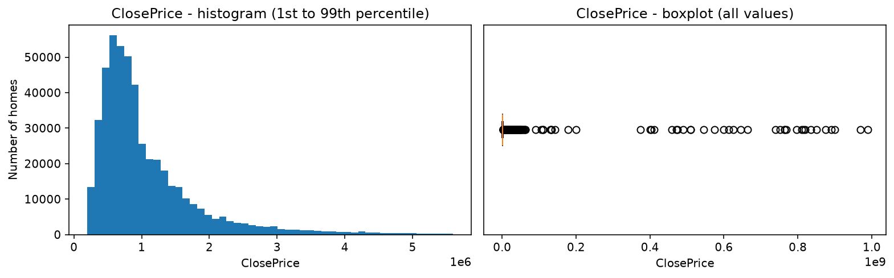
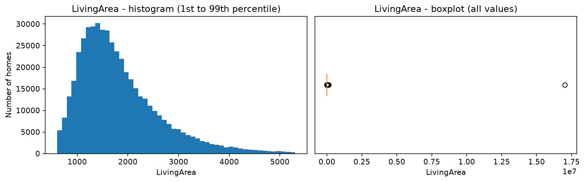
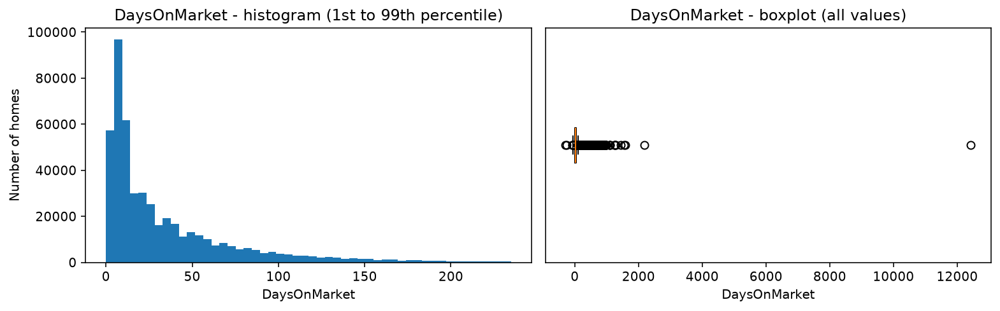

# IDX Exchange Data Analyst Internship

Weekly deliverables for the IDX Exchange Data Analyst internship.

## Week 1: Monthly Dataset Aggregation

**Script:** `IDXweek1_aggregate.py`

Combines monthly CRMLS files into two datasets with one for sold properties
and one for listings (spans January 2024 - September 2026).

### Script Function

1. Finds all monthly Sold and Listing CSV files in the data folder
2. Reads each file and prints its row count
3. Concatenates the monthly files into one dataset per type
4. Filters each dataset to `PropertyType == 'Residential'`
5. Saves the results as two new CSV files

### Results

| Dataset  | Monthly files | Rows after concat | Rows after Residential filter |
|----------|---------------|-------------------|-------------------------------|
| Sold     | 33            | 736,333           | 495,195                       |
| Listings | 33            | 1,046,356         | 665,393                       |

Row counts before and after concatenation matched for both datasets.

### Note:

The MLS data files are confidential and not included in this repository.

## Weeks 2-3: Dataset Structuring and Validation (Sold)

**Script:** `IDXweek2_sold_eda.py`

Inspects the combined sold dataset, documents property types, filters to
Residential, reports missing values, and summarizes key numeric fields.
Saves the filtered dataset as `sold_residential_validated.csv`.

Last run: 10/5/2026

### Dataset structure

- 33 monthly files, 736,333 rows and 84 columns before filtering
- Date fields (`CloseDate`, `ListingContractDate`, `PurchaseContractDate`,
  `ContractStatusChangeDate`) are stored as text and will need converting
- `latfilled` and `lonfilled` are not standard MLS fields (pending for later)

### Property types and filter

| Property type       | Rows    | Share  |
|---------------------|---------|--------|
| Residential         | 495,195 | 67.25% |
| ResidentialLease    | 169,422 | 23.01% |
| Land                | 23,303  | 3.16%  |
| ResidentialIncome   | 19,786  | 2.69%  |
| ManufacturedInPark  | 19,762  | 2.68%  |
| CommercialSale      | 4,558   | 0.62%  |
| CommercialLease     | 3,833   | 0.52%  |
| BusinessOpportunity | 474     | 0.06%  |

Filtering logic: `sold = sold[sold.PropertyType == 'Residential']`

| | Rows |
|---|---|
| Before filter | 736,333 |
| After filter  | 495,195 |
| Removed       | 241,138 |

### Missing value report

15 columns are above 90% missing:

- **100% missing:** TaxYear, FireplacesTotal, TaxAnnualAmount,
  AboveGradeFinishedArea, ElementarySchoolDistrict, BusinessType,
  CoveredSpaces, MiddleOrJuniorSchoolDistrict
- **90-99.9% missing:** WaterfrontYN (99.94), BelowGradeFinishedArea (99.39),
  BasementYN (98.04), BuilderName (95.14), LotSizeDimensions (95.12),
  BuildingAreaTotal (92.98), CoBuyerAgentFirstName (90.79)

Decision: dropped all 15 (none are core analysis fields). Columns went from
84 to 69, with rows unchanged at 495,195.

Key fields are nearly complete: ClosePrice (2 rows missing), ListPrice (0),
DaysOnMarket (0), CloseDate (0), LivingArea (0.06%), YearBuilt (0.09%),
Latitude/Longitude (0.97%), LotSizeAcres (7.67%).

### Numeric distribution summary

| Field                 | Min  | 1%      | 25%     | Median  | Mean      | 75%       | 99%       | Max           |
|-----------------------|------|---------|---------|---------|-----------|-----------|-----------|---------------|
| ClosePrice            | 0    | 200,000 | 575,000 | 825,000 | 1,189,657 | 1,300,000 | 5,600,000 | 989,500,000   |
| LivingArea            | 0    | 606     | 1,250   | 1,648   | 1,903     | 2,227     | 5,300     | 17,021,321    |
| DaysOnMarket          | -288 | 0       | 8       | 19      | 38        | 49        | 235       | 12,430        |
| ListPrice             | 1    | 210,000 | 575,000 | 819,000 | 1,145,011 | 1,295,000 | 5,795,000 | 170,000,000   |
| OriginalListPrice     | 0    | 210,000 | 585,000 | 829,000 | 1,227,971 | 1,299,000 | 5,995,000 | 1,390,000,000 |
| LotSizeAcres          | 0    | 0.00    | 0.12    | 0.17    | 58.32     | 0.28      | 10.99     | 7,810,698     |
| BedroomsTotal         | 0    | 1       | 3       | 3       | 3.21      | 4         | 6         | 45            |
| BathroomsTotalInteger | 0    | 1       | 2       | 2       | 2.54      | 3         | 6         | 175           |
| YearBuilt             | 1776 | 1912    | 1960    | 1979    | 1979      | 1999      | 2025      | 2027          |

### Distribution charts

Histograms show the 1st-99th percentile and boxplots show all values. ClosePrice and DaysOnMarket are right-skewed (mean is higher than median). 
ClosePrice peaks around 600,000-800,000 and DaysOnMarket peaks at 5-10 days.

### Extreme outliers identified (to handle in later weeks)

- ClosePrice: 0, and values up to 989.5 million
- LivingArea: 0, and up to ~17 million sq ft
- DaysOnMarket: negative values (min -288), and up to 12,430
- ListPrice: as low as 1, and up to 170 million
- OriginalListPrice: 0, and up to 1.39 billion
- LotSizeAcres: up to 7.8 million (mean 58.32 vs. median 0.17)
- BedroomsTotal: 0, and up to 45
- BathroomsTotalInteger: 0, and up to 175
- YearBuilt: as early as 1776, and as late as 2027

The 1st-99th percentile range is plausible for all nine fields.

### Suggested question responses

- **Residential share:** 67.25% of all sold records
- **Median and average close price:** 825,000 and 1,189,657
- **Days on Market:** right-skewed, median 19 days, 75% sold within 49 days
- **Sold above vs. below list price:** 39.62% above, 42.93% below,
  17.44% at list price
- **Close date before listing date:** 75 rows (to handle in later weeks)
- **Highest median price counties:** San Mateo (1,700,000),
  Santa Clara (1,590,000), San Francisco (1,200,000),
  Santa Cruz (1,188,000), Orange (1,185,000). Del Norte, Alpine, and
  Other County also rank in the top 10 but have only 1-5 sales each,
  so their medians are not very reliable.

### Market analysis fields vs. metadata fields

Classified by whether a field can be grouped, averaged, or counted for
market analysis, or only identifies/tracks a record. Covers the 69 columns
remaining after the drop.

**Market analysis fields (55)**

- **Price:** ClosePrice, ListPrice, OriginalListPrice
- **Dates and timing:** CloseDate, ListingContractDate,
  PurchaseContractDate, ContractStatusChangeDate, DaysOnMarket
- **Property type and status:** PropertyType, PropertySubType, MlsStatus
- **Size and features:** LivingArea, LotSizeAcres, LotSizeSquareFeet,
  LotSizeArea, BedroomsTotal, BathroomsTotalInteger, MainLevelBedrooms,
  YearBuilt, Stories, Levels, GarageSpaces, ParkingTotal, AttachedGarageYN,
  FireplaceYN, PoolPrivateYN, ViewYN, NewConstructionYN, Flooring
- **Location:** CountyOrParish, City, PostalCode, StateOrProvince,
  MLSAreaMajor, SubdivisionName, Latitude, Longitude, ElementarySchool,
  MiddleOrJuniorSchool, HighSchool, HighSchoolDistrict
- **Fees:** AssociationFee, AssociationFeeFrequency
- **Agents and offices:** ListAgentFullName, ListAgentFirstName,
  ListAgentLastName, ListOfficeName, CoListAgentFirstName,
  CoListAgentLastName, CoListOfficeName, BuyerAgentFirstName,
  BuyerAgentLastName, BuyerOfficeName, BuyerAgencyCompensation,
  BuyerAgencyCompensationType

**Metadata fields (14)**

- **Record and property identifiers:** ListingKey (primary key),
  ListingKeyNumeric, ListingId, UnparsedAddress, StreetNumberNumeric
- **Agent, office, and system identifiers:** BuyerAgentMlsId,
  ListAgentEmail, ListAgentAOR, BuyerAgentAOR, BuyerOfficeAOR,
  OriginatingSystemName, OriginatingSystemSubName
- **Data pipeline flags:** latfilled, lonfilled

## Weeks 2-3: Dataset Structuring and Validation (Listings)

**Script:** `IDXweek2_listings_eda.py`

Inspects the combined listings dataset, documents property types, filters to
Residential, reports missing values, and summarizes key numeric fields.
Saves the filtered dataset as `listings_residential_validated.csv`.
Charts and suggested questions are covered in the sold section above.

Last run: 10/11/2026

### Dataset structure

- 33 monthly files, 1,046,356 rows and 84 columns before filtering
- 11 columns are duplicated with a `.1` suffix (`PropertyType.1`,
  `DaysOnMarket.1`, `LivingArea.1`, `Latitude.1`, `Longitude.1`,
  `ListPrice.1`, `CloseDate.1`, `ListAgentFirstName.1`,
  `ListAgentLastName.1`, `BuyerOfficeName.1`, `UnparsedAddress.1`) because
  the extraction script requests those fields twice. Missing counts match
  their originals. To remove in Weeks 4-5 (redundant columns).
- Date fields are stored as text and will need converting (same as sold)

### Property types and filter

| Property type       | Rows    | Share  |
|---------------------|---------|--------|
| Residential         | 665,393 | 63.59% |
| ResidentialLease    | 217,698 | 20.81% |
| Land                | 67,819  | 6.48%  |
| ResidentialIncome   | 38,745  | 3.70%  |
| ManufacturedInPark  | 29,767  | 2.84%  |
| CommercialSale      | 14,340  | 1.37%  |
| CommercialLease     | 9,362   | 0.89%  |
| BusinessOpportunity | 3,232   | 0.31%  |

Filtering logic: `listings = listings[listings.PropertyType == 'Residential']`

| | Rows |
|---|---|
| Before filter | 1,046,356 |
| After filter  | 665,393 |
| Removed       | 380,963 |

### Missing value report

13 columns are above 90% missing:

- **100% missing:** TaxYear, TaxAnnualAmount, AboveGradeFinishedArea,
  FireplacesTotal, ElementarySchoolDistrict, BusinessType, CoveredSpaces,
  MiddleOrJuniorSchoolDistrict
- **90-99.9% missing:** BelowGradeFinishedArea (99.41),
  CoBuyerAgentFirstName (97.05), BuilderName (95.41),
  LotSizeDimensions (94.77), BuildingAreaTotal (91.19)

Decision: dropped all 13 (none are core analysis fields). Columns went from
84 to 71, with rows unchanged at 665,393.

Key fields: ListPrice (0 missing), DaysOnMarket (0), ListingContractDate (0),
LivingArea (0.10%), YearBuilt (0.17%), LotSizeAcres (8.04%),
Latitude/Longitude (12.24%). ClosePrice (70.51%) and CloseDate (67.02%) are
missing for listings that had not closed when the data was pulled.

### Numeric distribution summary

| Field                 | Min  | 1%      | 25%     | Median  | Mean      | 75%       | 99%       | Max           |
|-----------------------|------|---------|---------|---------|-----------|-----------|-----------|---------------|
| ClosePrice            | 525  | 215,000 | 599,000 | 850,000 | 1,197,009 | 1,350,000 | 5,550,000 | 820,000,000   |
| LivingArea            | 0    | 588     | 1,248   | 1,671   | 1,974     | 2,300     | 6,269     | 17,021,321    |
| DaysOnMarket          | -75  | 0       | 5       | 11      | 21        | 24        | 141       | 731           |
| ListPrice             | 1    | 210,000 | 579,900 | 840,000 | 1,308,394 | 1,370,000 | 8,000,000 | 400,000,000   |
| OriginalListPrice     | 0    | 200,000 | 585,000 | 849,000 | 1,390,214 | 1,388,000 | 8,499,000 | 1,749,000,000 |
| LotSizeAcres          | 0    | 0.00    | 0.12    | 0.17    | 59.15     | 0.32      | 13.50     | 4,187,292     |
| BedroomsTotal         | 0    | 1       | 2       | 3       | 3.23      | 4         | 6         | 94            |
| BathroomsTotalInteger | 0    | 1       | 2       | 2       | 2.63      | 3         | 7         | 2,208         |
| YearBuilt             | 1776 | 1911    | 1961    | 1980    | 1980      | 2001      | 2026      | 2028          |

The first three rows are the deliverable fields. ClosePrice is based on the
196,224 listings that closed.

### Extreme outliers identified (to handle in later weeks)

- ClosePrice: as low as 525, and up to 820 million
- LivingArea: 0, and up to ~17 million sq ft
- DaysOnMarket: negative values (min -75), and up to 731
- ListPrice: as low as 1, and up to 400 million
- OriginalListPrice: 0, and up to 1.75 billion
- LotSizeAcres: up to 4.2 million (mean 59.15 vs. median 0.17)
- BedroomsTotal: 0, and up to 94
- BathroomsTotalInteger: 0, and up to 2,208
- YearBuilt: as early as 1776, and as late as 2028

The 1st-99th percentile range is plausible for all nine fields.

### Market analysis fields vs. metadata fields

Same classification as the sold section, covering the 60 unique fields after
the drop (71 columns minus the 11 duplicates). Fields in the sold data that
are not in the listings data:

- **Market analysis (not present):** Flooring, ViewYN, PoolPrivateYN
- **Metadata (not present):** ListAgentAOR, BuyerAgentAOR,
  OriginatingSystemName, OriginatingSystemSubName, latfilled, lonfilled

Result: 52 market analysis fields and 8 metadata fields.

## Weeks 2-3: Mortgage Rate Enrichment

**Script:** `IDXweek3_mortgage_enrichment.py`

Fetches the 30-year fixed mortgage rate from FRED, resamples
it from weekly to monthly averages, then merges it onto both validated
datasets using a year_month key (saves both enriched datasets as new CSVs).

Last run: 10/12/2026

### Steps

1. Fetched 2,898 weekly rates from FRED
2. Resampled weekly rates to monthly averages
3. Created a `year_month` key on each dataset (sold from `CloseDate`,
   listings from `ListingContractDate`)
4. Left merged the monthly rates onto both datasets
5. Validated that no rows are missing a rate

### Merge validation

| Dataset  | Rows before merge | Rows after merge | Rows missing a rate |
|----------|-------------------|------------------|---------------------|
| Sold     | 495,195           | 495,195          | 0                   |
| Listings | 665,393           | 665,393          | 0                   |

Monthly rates for January 2024 - September 2026 ranged from 6.05%
(February 2026) to 7.06% (May 2024).

### Output

- `sold_with_rates.csv` and `listings_with_rates.csv`, each with two new
  columns: `year_month` and `rate_30yr_fixed`

## Weeks 4-5: Data Cleaning and Preparation (Sold)

**Script:** `IDXweek4_sold_cleaning.py`

Cleans the enriched sold dataset: converts date fields, removes redundant
columns, handles missing and invalid values, flags date and geographic
issues, and saves an analysis-ready CSV as `sold_cleaned.csv`.

Last run: 10/19/2026

### Row and column counts

| | Rows | Columns |
|---|---|---|
| Before cleaning | 495,195 | 71 |
| After cleaning  | 495,192 | 66 |

### Transformations

**1. Date fields converted to datetime**

CloseDate, PurchaseContractDate, ListingContractDate, and
ContractStatusChangeDate converted from text to `datetime64`.
0 unreadable dates in any field.

**2. Redundant and unnecessary columns removed (12)**

- **Redundant:** ListingKeyNumeric (exact copy of ListingKey),
  ListAgentFirstName and ListAgentLastName (combined in ListAgentFullName),
  LotSizeSquareFeet (same as LotSizeAcres), LotSizeArea (mixed units)
- **Metadata not used for analysis:** ListAgentEmail, BuyerAgentMlsId,
  ListAgentAOR, BuyerAgentAOR, BuyerOfficeAOR, OriginatingSystemName,
  OriginatingSystemSubName

**3. Missing values**

- Removed 2 rows missing ClosePrice (unusable for price metrics)
- All other missing values left blank (they mostly mean the field does not
  apply or was not provided, and filling them in would invent data)

**4. Numeric field types confirmed**

ClosePrice, ListPrice, OriginalListPrice, LivingArea, LotSizeAcres,
BedroomsTotal, BathroomsTotalInteger, DaysOnMarket, YearBuilt, and
rate_30yr_fixed are all numeric types (no conversion needed).

**5. Invalid numeric values**

| Rule | Records | Action |
|---|---|---|
| ClosePrice <= 0 | 1 | Row removed (sale unusable) |
| LivingArea <= 0 | 177 | Value set to missing (sale kept) |
| DaysOnMarket < 0 | 56 | Value set to missing (sale kept) |
| BedroomsTotal < 0 | 0 | None needed |
| BathroomsTotalInteger < 0 | 0 | None needed |

**6. Date consistency flags**

Expected order: ListingContractDate, PurchaseContractDate, then
CloseDate. Records are flagged as opposed to removed.

| Flag | Records |
|---|---|
| `listing_after_close_flag` | 75 |
| `purchase_after_close_flag` | 242 |
| `negative_timeline_flag` (contract before listing) | 315 |

Some contract-before-listing records may be private sales entered into the
MLS after the fact rather than errors.

**7. Geographic data quality**

| Flag | Records |
|---|---|
| `missing_coords_flag` | 4,796 |
| `zero_coords_flag` | 46 |
| `positive_longitude_flag` | 35 |
| `out_of_state_flag` (outside an approximate California boundary) | 116 |

The out-of-state count includes the zero and positive-longitude records.
About 1% of sales have a coordinate issue (mostly missing coordinates).

## Weeks 4-5: Data Cleaning and Preparation (Listings)

**Script:** `IDXweek4_listings_cleaning.py`

Cleans the enriched listings dataset: removes duplicate columns, converts
date fields, removes redundant columns, handles missing and invalid values,
flags date and geographic issues, and saves an analysis-ready CSV as
`listings_cleaned.csv`. Follows the same steps as the sold script.

Last run: 10/26/2026

### Row and column counts

| | Rows | Columns |
|---|---|---|
| Before cleaning | 665,393 | 73 |
| After cleaning  | 665,393 | 61 |

### Transformations

**1. Duplicate columns removed (11)**

The 11 `.1` columns documented in Weeks 2-3 were each confirmed to be an
exact copy of their original before removal.

**2. Date fields converted to datetime**

CloseDate, PurchaseContractDate, ListingContractDate, and
ContractStatusChangeDate converted from text to datetime.
0 unreadable dates in any field.

**3. Redundant and unnecessary columns removed (8)**

- **Redundant:** same 5 columns as the sold script
- **Metadata not used for analysis:** ListAgentEmail, BuyerAgentMlsId,
  BuyerOfficeAOR (the other sold metadata fields are not in the listings data)

**4. Missing values**

- No rows removed: a listing without a close price has not sold yet, and the
  core listing fields (ListPrice, ListingContractDate) are complete
- All missing values left blank
- About 23,000 listings have a CloseDate but no ClosePrice (469,169 vs.
  445,925 blanks). Possibly listings that ended without a sale; to review later

**5. Numeric field types confirmed**

Same 10 fields as the sold script (all numeric types, no conversion needed).

**6. Invalid numeric values**

| Rule | Records | Action |
|---|---|---|
| ClosePrice <= 0 | 0 | None needed |
| LivingArea <= 0 | 429 | Value set to missing (listing kept) |
| DaysOnMarket < 0 | 34 | Value set to missing (listing kept) |
| BedroomsTotal < 0 | 0 | None needed |
| BathroomsTotalInteger < 0 | 0 | None needed |

**7. Date consistency flags**

| Flag | Records |
|---|---|
| `listing_after_close_flag` | 91 |
| `purchase_after_close_flag` | 266 |
| `negative_timeline_flag` (contract before listing) | 325 |

Counts are close to the sold dataset since listings that sold appear in both.

**8. Geographic data quality**

| Flag | Records |
|---|---|
| `missing_coords_flag` | 81,441 |
| `zero_coords_flag` | 92 |
| `positive_longitude_flag` | 98 |
| `out_of_state_flag` (outside an approximate California boundary) | 402 |

About 12% of listings are missing coordinates compared with 1% of sales
(the listings files did not have coordinates filled in). Zip code
fields are nearly complete so zip-level analysis is not affected.

## Week 6: Feature Engineering and Market Metrics

**Script:** `IDXweek6_sold_metrics.py`

Creates market metrics from the cleaned sold dataset: price ratios, price
per square foot, time fields, and timeline durations. Summarizes the
metrics by county and property subtype, and saves the dataset as
`sold_metrics.csv`.

Last run: 11/8/2026

### Metrics created

| Metric | Column | Formula |
|---|---|---|
| Price Ratio | `price_ratio` | ClosePrice / ListPrice |
| Close to Original List Ratio | `close_to_original_list_ratio` | ClosePrice / OriginalListPrice |
| Price Per Square Foot | `price_per_sqft` | ClosePrice / LivingArea |
| Days on Market | `DaysOnMarket` | Existing field |
| Year, Month | `close_year`, `close_month` | From CloseDate |
| YrMo | `year_month` | From CloseDate |
| Listing to Contract Days | `listing_to_contract_days` | PurchaseContractDate - ListingContractDate |
| Contract to Close Days | `contract_to_close_days` | CloseDate - PurchaseContractDate |

Notes:
- The handbook gives Price Ratio and Close to Original List Ratio the same
  formula. Price Ratio uses ListPrice here (sold-to-list ratio).
- 2 records with an OriginalListPrice of 0 are treated as missing for the
  close to original list ratio.

### Validation

Negative timeline durations match the Weeks 4-5 date flags exactly:

| Check | Records |
|---|---|
| Negative listing to contract days | 315 |
| `negative_timeline_flag` | 315 |
| Negative contract to close days | 242 |
| `purchase_after_close_flag` | 242 |

### Metric summary

| Metric | 25% | Median | 75% |
|---|---|---|---|
| Price ratio | 0.98 | 1.00 | 1.02 |
| Close to original list ratio | 0.95 | 0.99 | 1.02 |
| Price per sq ft | 367 | 536 | 731 |
| Days on market | 8 | 19 | 49 |
| Listing to contract days | 10 | 25 | 59 |
| Contract to close days | 21 | 29 | 36 |

Extreme values remain in every metric (e.g. price ratio up to 200,200 and
listing to contract days as low as -36,407) caused by outliers documented
in Weeks 2-3 (To handle in Week 7)

### Segment summary: top 10 counties by sales

| County | Sales | Median price | Median $/sq ft | Median DOM | Median price ratio |
|---|---|---|---|---|---|
| Los Angeles | 123,080 | 905,000 | 609 | 19 | 1.00 |
| Riverside | 68,305 | 600,000 | 321 | 30 | 1.00 |
| San Diego | 61,636 | 900,000 | 590 | 15 | 1.00 |
| Orange | 55,781 | 1,185,000 | 675 | 15 | 1.00 |
| San Bernardino | 46,075 | 535,000 | 332 | 25 | 1.00 |
| Alameda | 23,428 | 1,130,000 | 699 | 14 | 1.02 |
| Contra Costa | 22,732 | 825,000 | 520 | 14 | 1.00 |
| Santa Clara | 21,068 | 1,590,000 | 962 | 10 | 1.02 |
| Ventura | 15,591 | 870,000 | 516 | 28 | 1.00 |
| San Mateo | 8,451 | 1,700,000 | 1,052 | 12 | 1.01 |

Bay Area counties have the highest prices per square foot and sell fastest while
Inland Empire counties (Riverside, San Bernardino) are the most affordable
and slowest.

### Segment summary: top 5 property subtypes by sales

| Subtype | Sales | Median price | Median $/sq ft | Median DOM |
|---|---|---|---|---|
| SingleFamilyResidence | 371,138 | 897,227 | 533 | 17 |
| Condominium | 81,132 | 625,000 | 562 | 25 |
| Townhouse | 29,026 | 800,000 | 558 | 18 |
| ManufacturedOnLand | 6,402 | 321,500 | 226 | 30 |
| Duplex | 2,776 | 910,000 | 544 | 22 |

The Residential property type also includes a few non-home subtypes
(BoatSlip: 104, Timeshare: 18, DeededParking: 6)

## Week 7: Outlier Detection and Data Quality

**Script:** `IDXweek7_sold_outliers.py`

Applies the IQR method to ClosePrice, LivingArea, and DaysOnMarket, adds
outlier flag columns, and saves both a full flagged dataset
(`sold_flagged.csv`) and a filtered analysis dataset (`sold_filtered.csv`).

Last run: 11/8/2026

### Method

For each field: Q1 and Q3 are the 25th and 75th percentiles, IQR = Q3 - Q1,
and values below Q1 - 1.5 × IQR or above Q3 + 1.5 × IQR are flagged.
Missing values are not flagged. Records are flagged but not deleted and the
filtered dataset excludes any record flagged in at least one field.

### IQR ranges and flags

| Field | IQR upper limit | 99th percentile | Records flagged | Share |
|---|---|---|---|---|
| ClosePrice | 2,387,500 | 5,600,000 | 37,067 | 7.5% |
| LivingArea | 3,692.5 | 5,300 | 21,668 | 4.4% |
| DaysOnMarket | 110.5 | 235 | 36,762 | 7.4% |

All lower limits are negative so IQR flags only the high end of each field.

New columns: `ClosePrice_outlier_flag`, `LivingArea_outlier_flag`,
`DaysOnMarket_outlier_flag`, and `any_outlier_flag` (flagged in any field)

### Dataset size

| Dataset | Rows | Columns |
|---|---|---|
| Full flagged (`sold_flagged.csv`) | 495,192 | 77 |
| Filtered (`sold_filtered.csv`) | 418,296 | 77 |
| Filtered out | 76,896 (15.53%) | |

### Median comparison

| Field | Before | After | Change |
|---|---|---|---|
| ClosePrice | 825,000 | 785,000 | -4.85% |
| LivingArea | 1,648 | 1,574 | -4.49% |
| DaysOnMarket | 19 | 16 | -15.79% |
| Price per sq ft | 536.00 | 525.37 | -1.98% |
| Price ratio | 1.00 | 1.00 | 0.00% |

### Written comparison

Filtering removes 15.53% of records and shifts the typical home toward a
lower price, a smaller size, and a faster sale. Days on market changes the
most (-15.79%) since slow-selling listings are removed.

The IQR limits are much stricter than the 1st-99th percentile range for all
three fields (e.g. 2.39 million vs. 5.6 million for ClosePrice) so
the flags include many real high-end and large homes along with clear data
errors. Price per square foot moves only 1.98% while price and size each
drop about 5%, which supports that most flagged homes are expensive because
they are large, not because their values are wrong. Negotiation strength is 
the same in both datasets because the price ratio does not change. 

Because of this, both datasets are kept. The filtered dataset suits
typical-home medians, while the full flagged dataset suits totals such as sales
counts and volume. A wider cutoff (3 × IQR) would flag only extreme values
and is an option if a less strict filter is needed.
